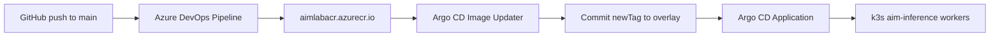

# Kubernetes manifests

Kustomize layout:

| Path | Purpose |
|------|---------|
| `base/` | Namespace, Redis, gateway (Deployment/Service/HPA/PDB), tissue-api, one Deployment + KEDA `ScaledObject` per model, shared config |
| `overlays/prod-gpu/` | GPU node pool selectors, NFS volumes, registry image tags, higher scaling ceilings |
| `overlays/k3s-local/` | The current single-node k3s host: hostPath volumes, HF cache, NodePort gateway (30080) and tissue-api (30800). Model workers pull from Azure Container Registry. |
| `overlays/dev-cpu/` | No GPUs: gateway + Redis + stub worker for smoke tests |
| `addons/` | Pinned KEDA and NVIDIA device plugin manifests (cluster-admin) |
| `argocd/` | Argo CD Application (+ Image Updater annotations) that syncs `overlays/k3s-local` |

## Local k3s, step by step (manual)

```bash
make images                                   # build images with Docker
make k8s-addons                               # KEDA + device plugin (once; cluster-admin)
make k8s-import-images                        # docker save | k3s ctr images import (gateway/tissue only once ACR owns workers)
deploy/k8s/overlays/k3s-local/create-secret.sh  # namespace + Secret from deploy/compose.env (kustomize never manages the Secret)
deploy/k8s/overlays/k3s-local/create-acr-pull-secret.sh  # ACR pull secret for workers
make k8s-apply-local                          # kubectl apply -k overlays/k3s-local
kubectl -n aim-inference get deploy,scaledobject,pods
curl -H "Authorization: Bearer $GATEWAY_API_TOKEN" http://127.0.0.1:30080/v1/models
```

Stop the compose stack first (`make compose-down`): both would claim the GPUs.

## CI/CD: Azure DevOps → ACR → Argo CD



### One-time bootstrap

1. **Azure resources** (already done on this host if following the plan):
   - Resource group `rg-aim-inference` (eastus2)
   - ACR `aimlabacr` → `aimlabacr.azurecr.io`
   - AcrPush service principal → `~/.config/aimlabacr-push-sp.json`
   - ACR pull token → `~/.config/aimlabacr-k3s-pull.{username,password}`

2. **Azure DevOps organization** (browser, once): this host uses **`aimlabdev`** (`https://dev.azure.com/aimlabdev`) and project **`cpathportal`**.

3. **PAT**: create a Personal Access Token with *Agent Pools (Read & manage)*, *Build (Read & execute)*, *Code (Read)*, *Service Connections (Read, query & manage)*. Export it:

   ```bash
   export AZURE_DEVOPS_EXT_PAT=...
   export ADO_ORG=https://dev.azure.com/aimlabdev
   # ADO_PROJECT defaults to cpathportal
   ```

4. **GitHub service connection**: in project `cpathportal`, add a GitHub connection named `github-extract-areas` that can read `pouya-codes/extract_areas` (needed before the pipeline create step).

5. **Project, pool, ARM connection, pipeline, agent**:

   ```bash
   deploy/azure-devops/bootstrap.sh
   ```

6. **ACR pull secret + Argo CD**:

   ```bash
   deploy/k8s/overlays/k3s-local/create-acr-pull-secret.sh
   deploy/k8s/argocd/install.sh
   ```

7. **Push branch `aimviwer2-AI`** (Argo tracks it; the CI/CD commit is local until pushed). This host has no GitHub credentials configured for `git push` yet:

   ```bash
   git push -u origin aimviwer2-AI
   ```

   Then enable auto-sync:

   ```bash
   kubectl -n argocd patch app aim-inference --type merge -p '{
     "spec":{"syncPolicy":{"automated":{"prune":false,"selfHeal":true},
       "syncOptions":["CreateNamespace=true","ServerSideApply=true"]}}}'
   kubectl -n argocd annotate app aim-inference argocd.argoproj.io/refresh=hard --overwrite
   ```

   Until the branch is on GitHub, sync from this checkout with:

   ```bash
   kubectl -n argocd port-forward svc/argocd-server 8081:443 &
   argocd login 127.0.0.1:8081 --username admin --password "$(kubectl -n argocd get secret argocd-initial-admin-secret -o jsonpath='{.data.password}' | base64 -d)" --insecure --grpc-web
   argocd app sync aim-inference --local deploy/k8s/overlays/k3s-local --local-repo-root "$PWD" --insecure --grpc-web
   ```

### Day-2 flow

1. Push to `aimviwer2-AI` or `main` (paths under `docker/`, `worker/`, `models/`, `module/`, … — see `azure-pipelines.yml`).
2. Pipeline `model-workers` builds the four targets on pool `k3s-host` and pushes:
   - `aimlabacr.azurecr.io/aimlab/aim-inference-worker-<model>:<short-sha>`
   - `…:main` (mutable tag Image Updater watches)
3. Image Updater sees the new `:main` digest and updates the live Application (write-back method `argocd`). Argo CD syncs; KEDA starts pods with the new image when work arrives.

Gateway and tissue-api stay on local `aimlab/…:dev` tags (not in this pipeline).

### Pin / roll back a worker

Edit the `images:` block in [`overlays/k3s-local/kustomization.yaml`](overlays/k3s-local/kustomization.yaml), set `newTag` to a previous short-sha that exists in ACR, commit to `main`. Argo CD self-heals to that tag. To freeze Image Updater temporarily, remove the app’s `argocd-image-updater.argoproj.io/image-list` annotation.

```bash
az acr repository show-tags -n aimlabacr --repository aimlab/aim-inference-worker-pdac -o table
```

### Secrets Argo CD must not own

- `inference-secrets` (`GATEWAY_API_TOKEN`, `HF_TOKEN`) — only [`overlays/k3s-local/create-secret.sh`](overlays/k3s-local/create-secret.sh)
- `acr-pull` — only [`overlays/k3s-local/create-acr-pull-secret.sh`](overlays/k3s-local/create-acr-pull-secret.sh)

## Any other cluster

```bash
kubectl kustomize deploy/k8s/overlays/prod-gpu | less      # inspect
kubectl apply -k deploy/k8s/overlays/prod-gpu
```

Prerequisites: the NVIDIA device plugin (so pods can request
`nvidia.com/gpu`) and KEDA (`ScaledObject`); both are in `addons/`.
