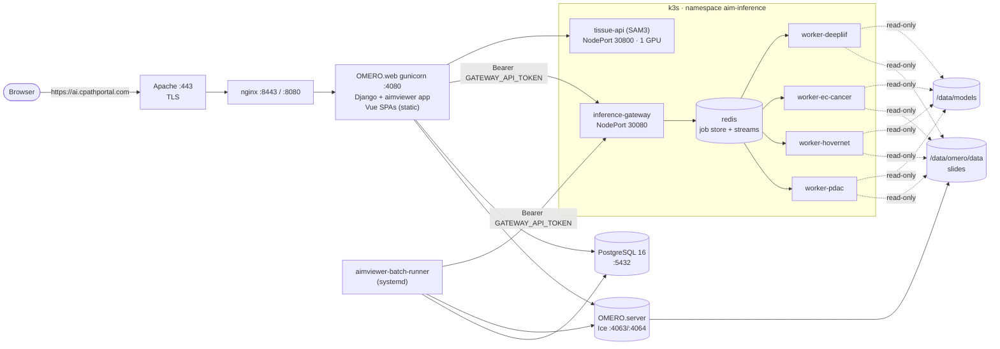
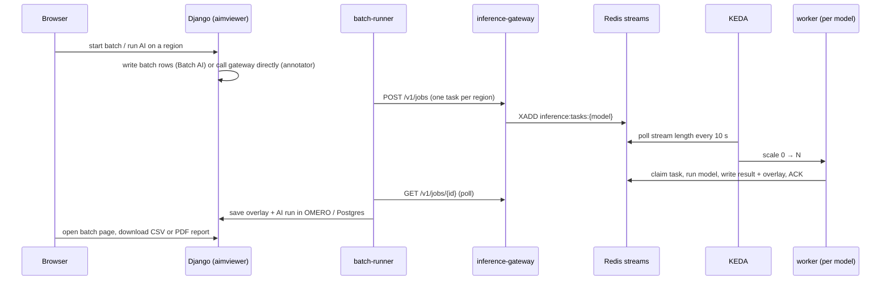
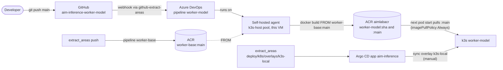

# cPathPortal platform: architecture, CI/CD and operations

How the whole cPathPortal system runs today (November 2026): the web portal,
the AI inference platform on k3s, and the pipeline that turns a push to a model
repo into a running worker. The last sections list what changed in the
November 2026 rollout and what is still open.

Deeper references:

| Topic | Document |
|---|---|
| Gateway, queue and worker design | [`MICROSERVICES_ARCHITECTURE.md`](MICROSERVICES_ARCHITECTURE.md) |
| k3s manifests, Argo CD, Day-2 commands | [`deploy/k8s/README.md`](../deploy/k8s/README.md) |
| Azure DevOps bootstrap | [`deploy/azure-devops/README.md`](../deploy/azure-devops/README.md) |
| Adding a model | [`ADDING_NEW_AI_MODELS.md`](../ADDING_NEW_AI_MODELS.md) |
| Portal pages, Batch AI, patients | `aimviewer/docs/PORTAL.md` |
| How AIMViewer calls the gateway | `aimviewer/docs/AI_INFERENCE_GATEWAY.md` |
| Sign-in (Entra ID + MFA) | `aimviewer/docs/ENTRA_SSO.md` |

## 1. The system at a glance

Everything runs on one Azure VM, `ai-cpathportal` (Ubuntu 24.04, 4× Tesla T4).
The web stack (OMERO, Django, Vue apps) runs directly on the host under
systemd. The AI stack runs in a single-node k3s cluster on the same host. The
two halves talk over two NodePorts.



## 2. Web portal (AIMViewer / cPathPortal)

Repository: `aimviewer` (Bitbucket `pathview/aimviewer`, working branch
`aimviewer2-agentic`), checked out at `~/code/aimviewer`.

### Request path

| Hop | Listens on | Notes |
|---|---|---|
| Apache | `*:80`, `*:443` | Terminates TLS for `ai.cpathportal.com` (`/etc/apache2/sites-enabled/reverse-proxy-portal.conf`) and proxies to nginx. The same Apache also hosts unrelated sites. |
| nginx | `127.0.0.1:8080`, `127.0.0.1:8443` | Site `omero-web`: serves `/static`, sends `/` to `/home`, proxies everything else to OMERO.web. |
| OMERO.web (gunicorn) | `:4080` | Django, with the `aimviewer` app installed as an OMERO.web plugin. Python venv `/home/ubuntu/prog/omero/venv_server`. |
| OMERO.server | `:4063/:4064` | Image server, systemd unit `omero@ubuntu`. Binary repository under `/data/omero/data`. |
| PostgreSQL 16 | `127.0.0.1:5432` | OMERO database plus the aimviewer tables (batches, patients, AI runs, access grants). Alembic migrations live in `aimviewer/alembic`. |

Sign-in goes through Microsoft Entra ID (OIDC with Conditional Access MFA).
The single-page apps reuse the OMERO.web session cookie.

### Frontends

All frontends are Vue/Vite apps under `aimviewer/frontend/`. `~/deploy.sh`
builds them, copies the output into OMERO.web's static directory, and
restarts OMERO.web.

| App | URL | Purpose |
|---|---|---|
| `dataset-manager` | `/home` | **cPathPortal home**: slide search, Batch AI, patients, access grants, tool shortcuts. |
| `annotator-v2` | slide viewer | Annotations and the *AI Region Process* panel. |
| `search` | `/search` | Similarity search. |
| `transfer` | `/transfer` | Slide import. |
| `admin` | `/admin` | Administration. |
| `agent` | `/agent` | SPARK agent. |

The OMERO webclient is still available at `/webclient/`.

### Background services (systemd)

| Unit | What it does |
|---|---|
| `aimviewer-batch-runner` | Runs Batch AI. For each slide it resolves regions, submits a gateway job as the submitter, polls it, merges overlays, and saves results to OMERO as the `mlbot` service account. At most 8 slides per user are in flight. State lives in Postgres, so the runner can restart at any time. |
| `aimviewer-notifier` | User notifications. |

Deploying a portal change: `~/code/aimviewer/deploy/portal.sh` runs the
migrations, runs `~/deploy.sh`, (re)installs the batch runner and checks the
nginx root redirect. Each step is safe to repeat.

### How the portal uses the AI platform

`aimviewer/config.yaml` points at the two NodePorts:

```yaml
AI_GATEWAY:
  URL: http://127.0.0.1:30080     # inference-gateway
  TOKEN: <GATEWAY_API_TOKEN>
AI_BACKENDS:
  general: http://127.0.0.1:30800 # tissue-api (SAM3 masks, tissue regions)
```



The gateway checks the bearer token and records the job owner that Django
sends. Django enforces that users only see their own jobs. Each user may have
at most 20 unfinished jobs (`MAX_ACTIVE_JOBS_PER_OWNER`); beyond that the
gateway returns 429.

## 3. AI inference platform on k3s

Repository: `extract_areas` (GitHub `pouya-codes/extract_areas`, branch
`aimviwer2-AI`), checked out at `~/code/extract_areas`. The k3s manifests are
in `deploy/k8s/base`, plus the overlay `deploy/k8s/overlays/k3s-local` for
this host.

### What runs in the cluster

| Namespace | Component | Image | Notes |
|---|---|---|---|
| `aim-inference` | `inference-gateway` | `aimlab/aim-inference-gateway:dev` (local) | FastAPI. One replica, NodePort 30080. Job API, model catalogue, overlays, `GET /v1/jobs/{id}/report.pdf`. |
| | `tissue-api` | `aimlab/aim-inference-tissue-api:dev` (local) | SAM3 mask and tissue-region helpers. One GPU, NodePort 30800. Called synchronously by Django. |
| | `redis` | `redis:7.4-alpine` | Job store and one stream per model (`inference:tasks:<model>`), with AOF persistence. |
| | `worker-pdac`, `worker-hovernet`, `worker-ec-cancer`, `worker-deepliif` | `aimlabacr.azurecr.io/aimlab/aim-inference-worker-<model>:main` | One GPU each. KEDA scales each from 0 to 4 replicas (4 GPUs on the host). Pulled with the `acr-pull` secret, `imagePullPolicy: Always`. |
| `keda` | KEDA operator, metrics API server, admission webhooks | | `redis-streams` ScaledObject per worker: stream-length mode, 10 s polling, 900 s cooldown. |
| `argocd` | Argo CD v3.6.1, Image Updater v0.17.0 | | Application `aim-inference`; see section 4. |
| `kube-system` | k3s core, NVIDIA device plugin | | Workers use `runtimeClassName: nvidia`. |

Scale-to-zero means that when nothing is queued, all four model workers are at
0/0. The first job for a model starts a pod, which loads its weights (from
`/data/models` and the Hugging Face cache) before taking tasks. The portal
shows this as "scale to zero" in the model list.

### Storage and secrets

| Mount | Host path | Used by |
|---|---|---|
| `slides` (read-only) | `/data/omero/data` | All workers and tissue-api, to read slides directly. |
| `model-weights` (read-only) | `/data/models` | All workers. |
| Hugging Face cache | `/data/models/hf-cache` | `worker-pdac` (GigaPath encoder), `tissue-api` (SAM3). |

| Secret | Created by | Contents |
|---|---|---|
| `inference-secrets` | `deploy/k8s/overlays/k3s-local/create-secret.sh` (reads `deploy/compose.env`) | `HF_TOKEN`, `GATEWAY_API_TOKEN` |
| `acr-pull` | `deploy/k8s/overlays/k3s-local/create-acr-pull-secret.sh` | ACR token `k3s-pull` (read-only) |

Kustomize does not manage either secret, so an Argo CD sync never overwrites
or deletes them. `deploy/compose.env` is git-ignored and must never be
committed.

## 4. CI/CD

### Repositories

| Repository (GitHub, private) | Contains | Image |
|---|---|---|
| `pouya-codes/extract_areas` | Gateway, worker runtime (`worker/`, `inference_platform/`), tissue-api, k8s manifests, Argo CD app | `aim-inference-worker-base` (CI); gateway and tissue-api are built locally |
| `pouya-codes/aim-inference-worker-pdac` | PDAC model code, `requirements.txt`, `Dockerfile` | `aim-inference-worker-pdac` |
| `pouya-codes/aim-inference-worker-hovernet` | HoVer-Net | `aim-inference-worker-hovernet` |
| `pouya-codes/aim-inference-worker-ec` | EC cancer | `aim-inference-worker-ec` |
| `pouya-codes/aim-inference-worker-deepliif` | DeepLIIF | `aim-inference-worker-deepliif` |
| `pouya-codes/aim-inference-worker-template` | Template repo for new models | none |

Every model Dockerfile starts `FROM aimlabacr.azurecr.io/aimlab/aim-inference-worker-base:main`
and only adds its own requirements and code. The shared runtime (queue
client, health and metrics endpoints, overlay writer) lives in the base image,
so a model repo never copies platform code.

### Azure resources

| Resource | Name |
|---|---|
| Resource group | `rg-aim-inference` (eastus2) |
| Container registry | `aimlabacr` → `aimlabacr.azurecr.io/aimlab/*` |
| Azure DevOps | org `aimlabdev`, project `cpathportal` |
| Agent pool | `k3s-host` (self-hosted). Agent `ai-cpathportal-k3s` runs on this VM from `/home/ubuntu/azdo-agent`. |
| Service connections | `aim-inference-acr` (Azure Resource Manager, AcrPush), `github-extract-areas` (GitHub, used for checkout) |

| Pipeline | Source repo | Trigger | Pushes |
|---|---|---|---|
| `worker-base` (id 1; `bootstrap.sh` created it as `model-workers`) | `extract_areas` / `azure-pipelines.yml` | push to `main` / `aimviwer2-AI` | `aim-inference-worker-base:<sha>` and `:main` |
| `worker-pdac`, `worker-hovernet`, `worker-ec`, `worker-deepliif` (ids 3–6) | the model repo / `azure-pipelines.yml` | push to `main` | `aim-inference-worker-<model>:<sha>` and `:main` |

Each pipeline step is one `AzureCLI@2` task on the host agent. It sets a
private `DOCKER_CONFIG` *before* `az acr login`, so the login and the push use
the same credential file. Then it runs `docker build`, tags `<sha>` and
`:main`, and pushes both. Checkout uses `submodules: false` in `extract_areas`
(the base image needs no model submodules).

### From a push to a running worker



In practice:

1. **Change a model:** push to `main` in its repo. When pipeline
   `worker-<model>` finishes, `…/aim-inference-worker-<model>:main` in ACR is
   the new build. The next time
   KEDA scales the worker up from zero, the pod pulls the new image. To switch
   a worker that is already running, use
   `kubectl -n aim-inference rollout restart deploy/worker-<model>`.
2. **Change the shared runtime:** push `extract_areas`. Pipeline `worker-base`
   rebuilds `worker-base:main`. Model images only pick it up when they are
   rebuilt, so queue the four `worker-*` pipelines (or push to each repo).
3. **Change cluster manifests** (resources, env, scaling, new worker
   Deployment): commit under `deploy/k8s/` on `aimviwer2-AI` and push. Argo CD
   shows the app OutOfSync; sync it from the UI or with `argocd app sync
   aim-inference`. Sync is manual on purpose for now (see section 7).
4. **Gateway or tissue-api:** not in CI. Build with `make images`, load into
   k3s with `make k8s-import-images`, then restart the deployment.
5. **Roll back a model:** list tags with
   `az acr repository show-tags -n aimlabacr --repository aimlab/aim-inference-worker-pdac -o table`.
   Set `newTag: <sha>` for that image in `overlays/k3s-local/kustomization.yaml`,
   then push and sync.

### Argo CD and Image Updater

The Application `aim-inference` (manifest:
`deploy/k8s/argocd/application.yaml`) tracks `extract_areas` at
`aimviwer2-AI`, path `deploy/k8s/overlays/k3s-local`. It ignores
`Deployment.spec.replicas`, because KEDA owns replica counts, and uses
server-side apply.

Image Updater is installed and the app carries its annotations (digest
strategy on the four `:main` images, write-back `argocd`). However, it does
not act yet: v0.17.0 skips the app ("not of supported source type") because
Argo CD 3.x leaves `status.sourceType` empty. Workers still get new builds
because they pull `:main` on every pod start.

## 5. Adding a new model

1. Create `pouya-codes/aim-inference-worker-<name>` from the
   `aim-inference-worker-template` repo. Put the model code under `models/`
   (and `module/`), and pin its Python dependencies in `requirements.txt`.
2. In Azure DevOps `cpathportal`, create a pipeline from that repo's
   `azure-pipelines.yml`. Use the GitHub connection `github-extract-areas` and
   pool `k3s-host`, and authorise the `aim-inference-acr` service connection on
   the first run.
3. In `extract_areas`, run `scripts/new_model.py` (`make new-model`). It
   scaffolds `deploy/k8s/base/workers/worker-<name>.yaml` (Deployment and KEDA
   ScaledObject on `inference:tasks:<name>`), lists it in the base
   kustomization, and adds a local-build Dockerfile stage. Then:
   - add the image to the `images:` block and the `acr-pull` label selector in
     `overlays/k3s-local/kustomization.yaml`;
   - add it to the Image Updater `image-list` annotation;
   - put the weights under `/data/models`.
4. Push both repos and sync Argo CD. The gateway lists the model in
   `GET /v1/models` and the portal shows it once the user's group has been
   granted the model.

[`ADDING_NEW_AI_MODELS.md`](../ADDING_NEW_AI_MODELS.md) has the full
checklist.

## 6. Operations cheat sheet

```bash
# Cluster state
kubectl -n aim-inference get deploy,scaledobject,pods
kubectl -n aim-inference logs deploy/inference-gateway -f
kubectl -n aim-inference logs deploy/worker-pdac --previous   # after a crash
kubectl -n argocd get application aim-inference

# Gateway (from the host)
curl -s localhost:30080/healthz
curl -s -H "Authorization: Bearer $GATEWAY_API_TOKEN" localhost:30080/v1/models | jq
curl -s -H "Authorization: Bearer $GATEWAY_API_TOKEN" localhost:30080/v1/queues | jq

# Force a worker onto the newest :main
kubectl -n aim-inference rollout restart deploy/worker-pdac

# Portal
journalctl -u aimviewer-batch-runner -f
~/code/aimviewer/deploy/portal.sh                      # migrations + build + restart

# CI agent (not a systemd service yet, see section 7)
pgrep -af Agent.Listener
cd /home/ubuntu/azdo-agent && sg docker -c './bin/Agent.Listener run --startuptype service' &
```

## 7. Known issues and next steps

| Issue | Impact | Suggested fix |
|---|---|---|
| Azure DevOps agent runs as a background process, not a systemd service | CI stops after a reboot until the agent is started by hand | `cd ~/azdo-agent && sudo ./svc.sh install ubuntu && sudo ./svc.sh start`, after making sure `ubuntu` is in the `docker` group for the service. |
| Image Updater skips `aim-inference` | Digests are not written back, so the Application does not record which build is running | Upgrade Image Updater to the 1.x line (CRD-based, supports Argo CD 3.x), or use `write-back-method: git` against the overlay. |
| Argo CD sync is manual | Manifest changes need a manual sync | When the branch is stable, add `syncPolicy.automated: {prune: true, selfHeal: true}` to `application.yaml`. |
| Gateway and tissue-api use local `:dev` images | Not reproducible from CI | Add both to the `worker-base` pipeline (or their own pipelines) and point the overlay at ACR. |
| Leftover Azure DevOps objects from the migration | Clutter | Delete the `seed-github-model-repos` pipeline (id 2), the `model-repo-bootstrap` repo, and the old `aim-inference-worker-*` mirror repos in ADO. |
| A GitHub PAT was pasted into a terminal during setup | Credential exposure | Revoke it on GitHub and create a fine-grained token if one is needed again. |
| Cluster manifests track `aimviwer2-AI`, not `main` | Two long-lived branches | Merge to `main` and repoint `targetRevision`. |

## 8. What was done in the November 2026 rollout

**Portal**

- Batch AI PDF report: `GET /aimviewer/api/v1/portal/batches/<id>/report.pdf`,
  with a *Download PDF* button on the batch page. It is rendered by
  `aimviewer/services/batch_report.py` from the same payload as the batch page,
  so the report and the page always agree (aimviewer `4fc97d9`).
- Gateway calls from Django and the batch runner send
  `Authorization: Bearer <GATEWAY_API_TOKEN>`.

**Inference platform** (`extract_areas`)

- `GET /v1/jobs/{id}/report.pdf` on the gateway: a ReportLab summary of a
  finished job, optionally with mask overlays. It returns 409 while the job
  is running (`f76a817`).
- Kustomize no longer manages `inference-secrets`, so syncs cannot wipe the
  tokens (`b676722`).
- Workers moved from local `:dev` images to ACR, with the `acr-pull` secret
  and the Argo CD Application plus Image Updater annotations (`90b97e0`,
  `bf90e21`).
- Shared `worker-base` Dockerfile stage; the platform pipeline now builds only
  that image (`e03d3e9`, `4bae169`, `377063a`).
- `worker-pdac` max replicas 4, matching the four GPUs (`24eb8a1`).
- Workers pull `:main` on every start, and the Day-2 docs were refreshed
  (`fdc983b`).

**Per-model repos and CI**

- Five private GitHub repos, `aim-inference-worker-{pdac,hovernet,ec,deepliif,template}`,
  seeded by `scripts/seed_model_repos.sh` and created by
  `scripts/push_model_repos.sh`. The push script keeps the token out of
  `.git/config` (`010b35b`).
- Azure DevOps project `cpathportal` with the self-hosted pool `k3s-host`, the
  `aim-inference-acr` and `github-extract-areas` service connections, and
  pipelines `worker-base` and `worker-*`, all green. All five images are in
  ACR, and the running workers use the `:main` images.
- CI fixes along the way:
  - the agent gained access to the Docker socket;
  - checkout moved from the Azure DevOps mirrors to GitHub;
  - `DOCKER_CONFIG` is now set before `az acr login`;
  - CI skips the SSH-only submodules;
  - the base build no longer needs the DeepLIIF submodule.
